# Distill — Enterprise Multimodal Storage Optimization

> **Ericsson Build Hackathon 2026 — "Data Storage Optimization" Challenge**  
> **Core Result:** Ericsson's files got **98.3% smaller**, and **nothing important was lost**.  
> All 12 Ericsson enterprise files are processed, deduplicated, and mathematically verified.

---

## 1. Executive Summary: What We Proved

Enterprise storage in modern telecommunications companies is overwhelmed by three hidden culprits:
1. **Uncompressed Video Recordings:** Multi-gigabyte meeting recordings where 95% of frames are static presentation slides.
2. **Presentation Deck Sprawl:** Multiple revisions of pitch decks (`Rev A`, `Rev B`, `Final`, `Final2`) re-uploaded across SharePoint and OneDrive.
3. **Redundant Employee Backups:** Local copies of files that already exist in governed central repositories.

Across the **12 real-world Ericsson enterprise files**, Distill achieved:
- **Original Archive Size:** **1.45 GB** (1,556,024,836 bytes)
- **Optimized Archive Size:** **24.9 MB** (26,087,879 bytes)
- **Net Storage Space Freed:** **98.3% space saved**
- **Mathematical Exactness (Waterfall Formula):**  
  Every single byte saved is strictly accounted for:  
  $$\text{1,556,024,836 B} - \text{1,522,715,191 B (videos)} - \text{3,772,216 B (duplicates)} - \text{3,449,550 B (slides)} = \mathbf{26,087,879\text{ B}}$$

---

## 2. System Architecture

Distill operates as a privacy-first, fully offline, CPU-optimized pipeline. It separates media into independent, content-addressable visual, auditory, and structural streams.

```mermaid
flowchart TD
    subgraph INGEST ["1. Enterprise Sources"]
        SP["SharePoint (Governed)"]
        OD["OneDrive (Personal)"]
        REC["Meeting Recordings (MP4)"]
    end

    subgraph PIPELINE ["2. Offline Multimodal Processing"]
        OCR["RapidOCR (Text Extraction)"]
        ASR["Whisper Base CPU (Opus Speech & Transcripts)"]
        PHASH["ImageHash (pHash / dHash)"]
        DIAR["Speaker Attribution & Chunks"]
    end

    subgraph CAS ["3. Content-Addressable Storage (CAS)"]
        STORE["Unique Slide Bitmaps (WebP)"]
        AUDIO["16 kbps Opus Speech Audio"]
        GRAPH["Revision & Version Chains"]
        REF["Cryptographic Pointers (SHA-256)"]
    end

    subgraph LEVELS ["4. Tiered Compression Engine"]
        L1["Level 1: Original (100% Untouched)"]
        L2["Level 2: Smaller Video (5 fps H.264)"]
        L3["Level 3: Audio + Slides + Text (97.8% Saved)"]
        L4["Level 4: Slides + Text (99.3% Saved)"]
        L5["Level 5: Text + Links (99.9% Saved)"]
    end

    subgraph VERIFY ["5. 'Nothing Was Lost' Verification Suite"]
        PSNR_CHK["PSNR & pHash (Video Quality)"]
        TEXT_CHK["SequenceMatcher (Text Retained %)"]
        SPEECH_CHK["Audio Duration & Speech Coverage"]
        REBUILD["Slide-by-Slide Content-ID Match"]
    end

    subgraph UI ["6. Enterprise Frontend (Next.js 15)"]
        DASH["Overview & Savings Projection"]
        FILE_VIEW["5-Position Level Slider & Rebuild"]
        DUP_VIEW["Duplicates & Slide Diff"]
        OFFBOARD["Departing Employee Audit"]
    end

    INGEST --> PIPELINE
    PIPELINE --> CAS
    CAS --> LEVELS
    LEVELS --> VERIFY
    VERIFY --> UI
```



---

## 3. The 5 Compression Levels (Verified Per Level)

Every compression level provides a distinct trade-off between playback fidelity and storage footprint. Crucially, **every level has its own measured and proven retention score**; Distill never defaults to an assumed 100%.

| Level | Plain English Name | Size Footprint | Verification Status | What is Preserved |
| :---: | :--- | :---: | :---: | :--- |
| **Level 1** | **Original** | **100%** (1.1 GB) | `Measured` | **Untouched original file**, byte-identical, verified against raw SHA-256 checksum. |
| **Level 2** | **Smaller video** | **~15%** (~160 MB) | `Measured` / `Estimated` | Playable video re-encoded at 5 frames/sec H.264. Measured via **PSNR (28.67 to 30.11 dB)** and pHash ($\le 12$). |
| **Level 3** | **Audio + slides + text** | **~2.2%** (~24 MB) | `Measured` | **16 kbps Opus speech audio** (duration diff $<0.01\text{s}$, up to 84.8% speech covered) + WebP slides + full transcript. |
| **Level 4** | **Slides + text** | **~0.7%** (~7.5 MB) | `Measured` | **95.8% to 99.7% on-screen text retained** + distinct slide pictures + speaker attribution. *(Recommended enterprise default).* |
| **Level 5** | **Text + links** | **~0.1%** (~1.2 MB) | `Measured` | Keyframe slides linked directly to official SharePoint presentation decks, eliminating duplicate slide images. |

---

## 4. "Git for Slides": Revision Delta Storage & Rebuild

Enterprise users frequently duplicate presentation decks across revisions (`Rev A` vs `Rev B`), changing only 2 or 3 slides while storing 25+ redundant high-resolution pages.

### The Algorithm:
1. **Canonical Governing:** The authoritative copy in SharePoint (`SD-WAN Rev B`) remains intact as the primary reference.
2. **Delta Decomposition:** Older revisions (`SD-WAN Rev A`) are stored strictly as differences:
   - **18 slides** identical to Rev B $\to$ point to Rev B in CAS (0 extra bytes).
   - **7 slides** modified or unique $\to$ saved as delta WebP pictures.
3. **On-Demand PDF Rebuild:**  
   Using `GET /api/files/11/rebuild?format=pdf`, Distill dynamically reconstructs the exact original Rev A presentation from the shared slides and delta pictures.
4. **Slide-by-Slide Verification:**  
   Every rebuilt slide is matched via cryptographic `content_id` (visible text + embedded graphics).  
   **Result: 25 out of 25 slides (100.0%) verified identical.**

---

## 5. "Nothing Was Lost" Verification Protocol

To give compliance and legal teams mathematical certainty, Distill implements a four-stage audit across all files:

1. **20 Evenly-Spaced Moments:**  
   For every recording, frames are sampled at moments $t = \text{duration} \times (i + 0.5) / 20$.
2. **Moving Video vs Static Slides:**  
   Consecutive frames ($t$ and $t + 1.0\text{s}$) are compared using 64-bit dHash (excluding live presenter webcam masks). If Hamming distance $> 10$, it is classified as `moving_video` (retained only in Levels 1–2 by design).
3. **Text Retained (Character-Level Matching):**  
   OCR text from kept pictures and linked official decks is evaluated against original frame text using `SequenceMatcher(autojunk=False)` with a 90% fuzzy match window.
   - **Tech Concept Hack recording (88 mins):** **95.8% text retained**, 90.0% visual match.
   - **GraalVM Compilation recording:** **99.7% text retained**, 100.0% visual match.
4. **Broadcast Quality Verification (PSNR):**  
   Re-encoded videos are tested against uncompressed originals using Peak Signal-to-Noise Ratio:
   - **Jury and prizes.mp4:** **30.11 dB PSNR** ($\ge 30\text{ dB}$ is standard broadcast threshold).
   - **GraalVMs MP4:** **28.67 dB PSNR**.

---

## 6. Complete Verification Results: All 12 Files

| File Name | Level / Type | Status | Text Retained | Visual Match | Verified Details & Guarantees |
| :--- | :---: | :---: | :---: | :---: | :--- |
| **Tech Concept Hack - Meeting Recording.mp4** | Level 1 | `measured` | 100.0% | 100.0% | Untouched original, SHA-256 bit-level match |
| | Level 2 | `estimated` | — | — | Estimated (recording > 2.5h; not pre-rendered to save disk) |
| | Level 3 | `measured` | 95.8% | 90.0% | Opus audio ($\Delta t = 0.01\text{s}$, 75.3% speech covered) + slides |
| | Level 4 | `measured` | 95.8% | 90.0% | Keyframe slides + timestamped transcript + speaker attribution |
| | Level 5 | `measured` | 95.8% | 70.0% | Links to official deck: linked text 95.3%, unlinked 96.3% (6 linked moments) |
| **GraalVMs_Ahead-of-Time_Compilation.mp4** | Level 1 | `measured` | 100.0% | 100.0% | Untouched original, SHA-256 bit-level match |
| | Level 2 | `measured` | 100.0% | 100.0% | **PSNR: 28.67 dB**, pHash match 100.0% (5 fps H.264) |
| | Level 3 | `measured` | 99.7% | 100.0% | Opus audio ($\Delta t = 0.00\text{s}$, 84.8% speech covered) + slides |
| | Level 4 | `measured` | 99.7% | 100.0% | Keyframe slides + timestamped transcript + speaker attribution |
| | Level 5 | `measured` | 99.7% | 100.0% | Exactly Level 4 numbers (0 linked moments to separate deck) |
| **Jury and prizes.mp4** | Level 1 | `measured` | — *(no text)* | 100.0% | Untouched original, SHA-256 bit-level match |
| | Level 2 | `measured` | — *(no text)* | 75.0% | **PSNR: 30.11 dB** (Broadcast quality), pHash match 100.0% |
| | Level 3 | `measured` | — *(no text)* | 75.0% | Opus audio ($\Delta t = 0.01\text{s}$, 60.8% speech covered) + slides |
| | Level 4 | `measured` | — *(no text)* | 75.0% | Keyframe slides + timestamped transcript + speaker attribution |
| | Level 5 | `measured` | — *(no text)* | 75.0% | Exactly Level 4 numbers: pictures 82.4%, visual 75.0% (0 linked moments) |
| **Ericsson Response Introduction.pdf** | Document | `proven` | — | — | **Proven (SHA-256)**: Bit-for-bit identical to governed original |
| **SD-WAN Orchestration (Rev B).pptx** | Document | `proven` | — | — | **Proven (SHA-256)**: Governed primary deck in SharePoint |
| **C2L_Presentation_Hackathon_RevB.pdf** | Document | `proven` | — | — | **Proven (SHA-256)**: Governed primary deck in SharePoint |
| **C2L_Presentation (1).pdf (OneDrive duplicate)** | Document | `proven` | — | — | **Canonical Reference**: 0 B binary, points to SharePoint copy |
| **SD-WAN Orchestration (Rev A).pptx** | Document | `proven` | — | — | **Rebuilt: 25/25 slides identical (content_id)** via delta |
| **Challenge_Ericsson.docx** | Document | `proven` | — | — | **Proven (SHA-256)**: Bit-for-bit identical to governed original |
| **Brief.png** | Document | `proven` | — | — | **Proven (SHA-256)**: Bit-for-bit identical to governed original |
| **Copy of Brief.png (OneDrive duplicate)** | Document | `proven` | — | — | **Canonical Reference**: 0 B binary, points to SharePoint copy |
| **The chat history timestamp.msg** | Document | `proven` | — | — | **Proven (SHA-256 text hash)**: Decompressed text verified |

---

## 7. Evaluator 2-Minute Guided Tour

When evaluating Distill, follow these steps in your browser:

### Step 1: Executive Overview (`http://localhost:3000/`)
- Look at the top headline: **1.45 GB $\to$ 24.9 MB (98.3% saved)**.
- Review the **Waterfall breakdown** showing the exact byte formula.
- Interact with the **Enterprise Savings Calculator**: adjust TB and see live cost (€/yr) and carbon (tonnes CO₂) avoidance projections.

### Step 2: The 5-Level Slider (`http://localhost:3000/files/6`)
- Open the 88-minute Tech Concept recording.
- Drag the **5-position level slider** (Level 1 $\to$ Level 5).
- Watch how Level 3 provides an interactive **Opus audio player** with synchronized slide transitions.
- Check the **"What is stored at this level"** folder view with exact file sizes from disk and one-click ZIP download.

### Step 3: "Was Anything Lost?" Verification
- Scroll to **Part 3** on any file.
- Notice the **level-specific badges**: `[Measured]`, `[Estimated]`, or `[Proven]`.
- Click the **"Open spot check"** button to open the side-by-side visual comparison of 20 moments.

### Step 4: "Git for Slides" Rebuild (`http://localhost:3000/files/11`)
- Open **SD-WAN Rev A** (File 11).
- Notice the **"Rebuilt: 25/25 slides identical (content_id)"** guarantee card.
- Click **"Download Rebuilt PDF"** to watch Distill reconstruct the presentation on the fly.
- Click **"Inspect Slide Comparison JSON"** to view slide-by-slide cryptographic provenance.

### Step 5: Duplicates & Offboarding Audit (`/duplicates` & `/offboarding`)
- Check `/duplicates` to see exact duplicate pairs and shared slide statistics.
- Check `/offboarding` to audit departing employee OneDrive drives against SharePoint.

---

## 8. How to Run Locally

### Prerequisites
- Python 3.10+ (CPU-optimized)
- Node.js 18+ and npm
- FFmpeg installed in system PATH

### Step 1: Clone the Repository
```bash
git clone https://github.com/VenkataVishnuVardhanReddy/Ericsson-Challenge.git
cd Ericsson-Challenge
```

### Step 2: Install Python Dependencies & Start Backend
```bash
# Optional: create a virtual environment
python -m venv .venv
# Windows: .\.venv\Scripts\activate
# Linux/macOS: source .venv/bin/activate

pip install -r requirements.txt
python -m uvicorn distill.app:app --host 127.0.0.1 --port 8000
```
Backend API will be running at `http://127.0.0.1:8000`.

### Step 3: Start the Next.js Frontend
In a second terminal:
```bash
cd frontend
npm install
npm run build
npm start
```
Open **`http://localhost:3000`** in any web browser.

### Step 4: Verify Database Verification Metrics Directly
To run the automated verification script from the command line:
```bash
python scripts/verify_levels.py
```

---

## 9. Key API Reference

| Endpoint | Method | Description |
| :--- | :---: | :--- |
| `/api/overview` | `GET` | Archive waterfall savings, per-source breakdown, and totals. |
| `/api/files` | `GET` | All 12 files with original bytes, size after, % saved, policy, and reason. |
| `/api/files/{id}/stages` | `GET` | 5 storage levels, progress stages, and processing methods. |
| `/api/files/{id}/integrity?level=N` | `GET` | Verified retention score, PSNR, audio match, and 20 moments for Level N. |
| `/api/files/{id}/levels/{level}/contents` | `GET` | Real files and exact disk byte breakdown stored at that level. |
| `/api/files/{id}/levels/{level}/download` | `GET` | Streams a ZIP archive of the exact files stored at that level. |
| `/api/files/{id}/rebuild?format=pdf` | `GET` | Rebuilds older revision deck as PDF from delta + shared slides. |
| `/api/files/{id}/rebuild?format=json` | `GET` | Slide-by-slide `content_id` equivalence audit. |
| `/api/duplicates` | `GET` | Duplicate groups, version chains, and shared slide statistics. |
| `/api/spot-check` | `GET` | Standalone HTML report comparing original frames against kept footage. |
| `/api/offboard` | `GET` | Departing employee drive audit against governed SharePoint repositories. |

---

## 10. Technology Stack

- **Backend:** FastAPI, Python 3.11, SQLite (FTS5 + WAL mode), RapidOCR, Faster-Whisper (int8 CPU), ImageHash, OpenCV, PyMuPDF.
- **Frontend:** Next.js 15 (App Router), React 19, Tailwind CSS 3, Lucide Icons.
- **Architecture Standard:** Monochromatic, high-contrast, accessibility-compliant enterprise design system.
