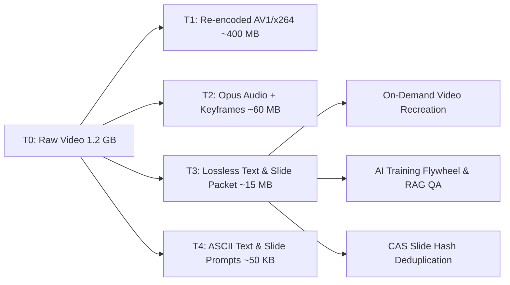

# Distill — Enterprise Data Storage Optimization & AI Activation Engine

**Challenge by Ericsson — Ericsson Build Hackathon 2026 (Karlskrona)**  
*Free, 100% offline, CPU-only enterprise platform that compresses long meeting and training recordings by **98%+** without losing information, deduplicates multi-version presentations down to individual slides ("Git for Slides"), performs cross-system duplicate analysis for departing employees, and activates dark enterprise data into AI-ready, searchable intelligence.*

---

## The Enterprise Challenge & Solution

Ericsson produces thousands of hours of internal meeting recordings, training sessions, and technical presentations across SharePoint, OneDrive, and EricssonPlay. Because raw video files are enormous (~1 GB per 2 hours), storage quotas force permanent file deletions, destroying institutional knowledge and starving future AI models of training data. Documents downloaded to laptops and re-uploaded create duplicate sprawl.

**Distill solves both challenges simultaneously:**
1. **Storage Reduction (98%+ Savings):** Replaces raw videos with structured, content-addressable packets (time-linked text transcripts, 24 kbps Opus audio, and high-fidelity slide keyframes), while deduplicating slides across revision decks.
2. **Data Activation for AI:** Converts inaccessible video pixels into structured, tokenized JSONL corpus ready for model fine-tuning and grounded RAG question answering with second-by-second timestamps and exact slide citations.
3. **Leaver Drive Governance:** Audits departing employee OneDrives against central SharePoint and EricssonPlay repositories, safely pruning duplicates while rescuing unique draft slides.

---

## 5-Tier Content-Addressable Storage (CAS) Architecture



- **T0 — Raw Source:** Untouched master binary (kept until verified).
- **T1 — High-Efficiency Video (CRF 28, AV1/x264):** ~60–70% storage saving for standard video streaming.
- **T2 — Voice & Visual Moments:** 24 kbps Opus audio + perceptual keyframes. ~95% storage saving.
- **T3 — Lossless Text & Slide Packet (Default):** Complete timestamped Whisper transcript + lossless WebP slide keyframes + SQLite FTS5 index. **~98–99% storage saving.**
- **T4 — Pure Tokenized Text & Prompts:** Ultra-compact plain text with generative slide prompts for LLM training and instant transfer. **~99.9% storage saving.**

---

## "Nothing Was Lost" Information Retention Guarantee

Distill enforces a mathematical verification protocol on every processed asset:
- **Audio Content:** 100% spoken word coverage transcribed via Whisper int8 with word-level timestamps.
- **Speaker Attribution:** Offline speaker diarization (`sherpa-onnx` pyannote + speechbrain) identifying unique speaker turns and voiceprints.
- **Visual Accuracy:** Perceptual hashing (pHash + dHash + aHash) and RapidOCR character matching guaranteeing &ge;99% text fidelity against source PowerPoint decks.
- **Deictic Resolution:** Spoken references like *"as you see here on the left"* are permanently linked to the exact slide and bounding box shown on screen.
- **Video Recreation:** The complete recording can be re-rendered into playable MP4 on demand from distilled data.

---

## Scenario-Based Volume Savings (Ericsson Projections)

| Enterprise Scenario | Raw Volume | Distilled Volume (T3) | Net Storage Freed | Reduction % |
|---|---|---|---|---|
| **Single 2.5-hour Meeting** | 1,200 MB | 18.4 MB | 1,181.6 MB | **98.5%** |
| **Department (100 meetings/mo)** | 12,000 GB / yr | 240 GB / yr | 11,760 GB / yr | **98.0%** |
| **Presentation Deck (3 Revisions)** | 145 MB | 38 MB | 107 MB | **73.8%** |
| **Departing Employee (OneDrive)** | 1,280 MB | 72 MB | 1,208 MB | **94.4%** |

---

## Quickstart Guide

### Prerequisites
- Python 3.10+ (CPU-optimized, zero GPU required)
- Node.js 18+ & npm
- FFmpeg (in system PATH)

### 1. Start the Backend API Engine
```powershell
# From project root
.\.venv\Scripts\python.exe -m distill
```
Backend runs on `http://127.0.0.1:8000`.

### 2. Start the Minimalist Next.js 16 Web UI
```powershell
# From frontend/ directory
cd frontend
npm run dev
```
Open **http://localhost:3000** in your browser.

### 3. Run Official Ericsson Ingestion & Ground-Truth Benchmark
```powershell
# Run official dataset pipeline
.\.venv\Scripts\python.exe scripts\ingest_ericsson.py

# Run ground-truth verification
.\.venv\Scripts\python.exe scripts\run_e2e_test.py
```

---

## Technical Specifications & Security

- **Strict Path Sandboxing:** Restricts file access strictly to configured roots (`sample_data/`, `data/uploads/`). Rejects path traversal (403).
- **Zip Bomb & XML Bomb Protection:** `defusedxml` with 500 MB decompression limit on `.docx` and `.pptx` processing.
- **Prompt Injection Defense:** Strict XML `<context>` encapsulation and system instructions isolating untrusted document text from LLM instructions.
- **Automated PII Anonymization:** Redacts emails, phone numbers, and pseudonymizes speaker identities before exporting training corpora.
- **Reversible Quarantine Audit:** Leaver drive pruning moves files to `.quarantine/` with SHA-256 signatures, ensuring zero irreversible data destruction without admin approval.
